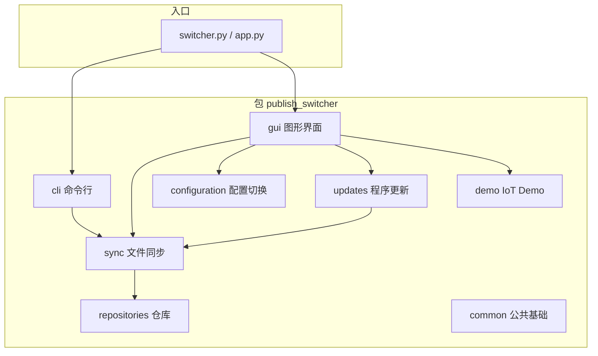

# 功能模块中文地图

注释写在各文件模块头与包 `__init__.py` 中，按下表对照即可。

| 功能 | 主要位置 |
|------|----------|
| 文件同步 / 严格更新 | `sync/` |
| 资源仓库与多通道 | `repositories/`、`updates/channels.py` |
| 配置切换与可见性 | `configuration/` |
| 启动自动更新与进度窗口 | `updates/startup.py`、`gui/startup.py` |
| 一键更新与独立恢复 | `updates/unified.py`、`updates/bootstrap.py` |
| IoT Demo | `demo/` |
| 用户界面 / 工程师面板 | `gui/` |
| SSH 菜单 | `cli/` |
